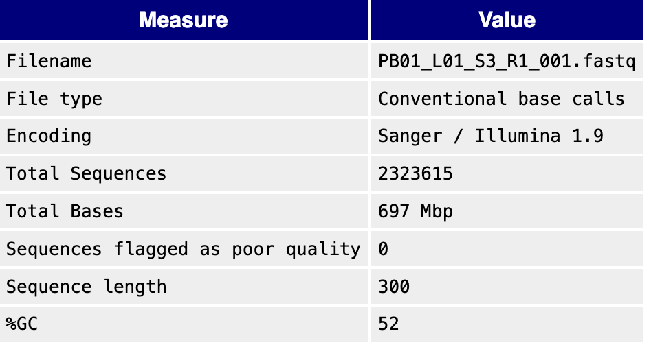
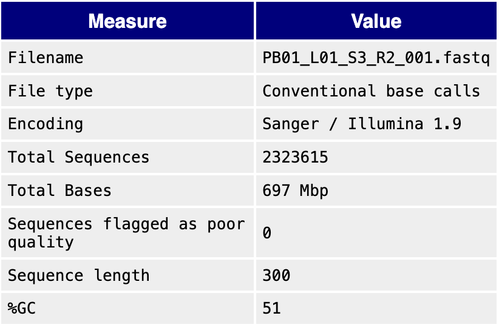

```{=html}
<!--
Before you push, check:
  [ ] this .qmd AND its rendered .html are both committed
  [ ] rendered from a clean session (Session > Restart R, then Render)
  [ ] paths are relative, not absolute: from notebooks/, use ../ (e.g. ../output/weekNN/)
  [ ] tables and figures are saved under output/weekNN/, not only printed here
  [ ] nothing under data/raw/ is committed
  [ ] software, platform, and container/environment are named
  [ ] the commit link is posted as a comment on your Project Proposal issue
Rubric: https://sr320.github.io/course-fish546-2026/how-we-work.html#weekly-entry-rubric
-->
```
## 1. This week's analysis

```{bash}
pwd
cd ..
cd ./data/raw
pwd
tar -xf 260810_PolarBear.tar #untar my tar file in prep for fastqc
gunzip -k *.gz #uncompress the fastq.gz files for my project

```

```{bash}
head ../data/raw/PB01_END01_S1_R1_001.fastq #making sure it looks right and theres base pairs there. Looks like there's stuff!

```

```{bash}
/home/shared/FastQC-0.12.1/fastqc -h #accessing fastqc software

```

```{bash}

/home/shared/FastQC-0.12.1/fastqc ../data/raw/PB01_L01_S3_R1_001.fastq ../data/raw/PB01_L01_S3_R2_001.fastq -o ~/Dailey-546/output/week2


```

```{bash}
md5sum ../data/raw/PB01_L01_S3_R1_001.fastq 
md5sum ../data/raw/PB01_L01_S3_R2_001.fastq
```

```{=html}
<!-- The week's exercise or your project step: commands, code, outputs, and what they mean.
     Link the files in output/weekNN/. Name the platform (laptop / Raven / Klone) and software versions. -->
```
1.  Record provenance: file source, date, sample names, and checksums.

2.  Count reads in each file.

    

    

3.  Run FastQC (and MultiQC if more than two files) on Raven. Save the reports under output/week02/.

4.  Identify adapters, primers, low-quality tails, overrepresented sequences, or other concerns.

5.  If trimming is justified, run a small trimming step and compare before and after summaries. Record the exact command, software version, and parameters.

6.  Write a one-paragraph decision: proceed, trim more, exclude a sample, or investigate.

I'd like to walk through trimming more in class this coming Thursday so I can be sure I'm understanding the steps. I saw using the shared software fastp but I have also heard of using dada2 for trimming so I'm unsure the pros and cons of both!

## 2. Reflection questions

1.  What does a per-base quality plot tell you, and what does it not tell you?

    A per-base quality plot is a tool that tells you the confidence the sequencer has in each base it reads across the length of the sequence. It tells you how well the run went overall. However, it will not tell you why the quality may be degraded, identify any biases in letter distribution, or if there are any duplicated reads. It is just a single tool that is part of the bigger picture in assessing the quality of your reads.

2.  When is trimming useful, and when might it remove useful information?

Trimming is useful for removing artificial adapter sequences introduced during library prep, as well as removing low quality reads (such as degraded reads that happen commonly towards the end of the reverse read) that would impact downstream analyses later. It is important to be judicious when trimming, because it can remove actual biological signal and valuable reads, or even mess up your ability to overlap and pair your reads.

3.  For your project, name the raw input format, the first QC step, and the first downstream analysis step.

For my project, my input is paired end 16s reads with rRNA sequences. My first QC step is running fastqc or multiqc (after checking out the first couple lines with head to make sure it looks correct). Then I believe my next step is merging paired end reads, denoising to get ASVs, removing chimeras, and assigning taxonomy to representative sequences (ASVs)

## 3. Project progress

-   I uncompressed my polar bear microbiome data, and then uncompressed the fastq.gz files so I can start working with them and using them for this week's analysis exercise.
-   Ran fastqc on the forward and reverse reads from one of my project samples

## 4. Where I'm stuck

-   I'm confused on if I need to create a fork

-   I need to get my checksums into the raw-checksum.txt file but unsure how to make this useful for me rather than just putting all the checksums in one spot without being labelled. Is there a way to make a table or something for this and automate that?

-   I have a script that someone shared with me for microbiome analysis but it primarily uses qiime and am struggling to figure out where the qiime workflow fits into Raven.

## 5. Next week

I am planning on trimming and merging my reads and doing further planning on the end goal for my project. I would love to continue to play around with qiime for visualizations.
